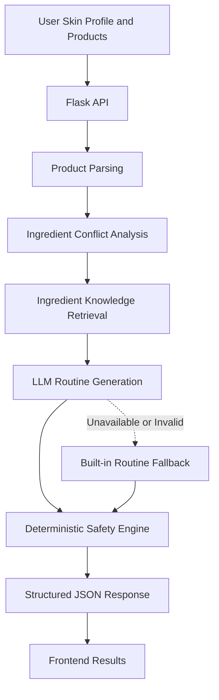

# 🌿 Glowithm — AI Skincare Routine Analyzer

**Understand your skin. Analyze your products. Build a smarter skincare routine.**

Glowithm is an AI-powered skincare routine analyzer that helps users understand their skin profile, review their existing skincare products, identify potential ingredient conflicts, and receive personalized morning and evening skincare routine suggestions.

The project combines a Flask backend, a locally hosted Large Language Model (LLM), ingredient compatibility data, a machine-learning classifier, and a deterministic safety engine to generate structured skincare guidance.

---

## Table of Contents

- [Features](#features)
- [How It Works](#how-it-works)
- [Technology Stack](#technology-stack)
- [Machine Learning Approach](#machine-learning-approach)
- [Model Evaluation](#model-evaluation)
- [Project Structure](#project-structure)
- [Getting Started](#getting-started)
- [API Overview](#api-overview)
- [Testing](#testing)
- [Limitations](#limitations)
- [Future Improvements](#future-improvements)
- [Disclaimer](#disclaimer)

## Features

- **Personalized Skin Analysis:** Analyze skincare needs using skin type and selected skin concerns.
- **Product Analysis:** Review user-provided skincare products and their recognized ingredients.
- **Ingredient Compatibility:** Identify potential ingredient conflicts using compatibility data and machine-learning estimates.
- **AI Routine Generation:** Generate personalized AM and PM skincare routine suggestions using a locally hosted language model.
- **Safety Validation:** Apply deterministic safety rules to validate and adjust AI-generated routines.
- **Ingredient Intelligence:** Explore ingredient information, benefits, usage guidance, and precautions.
- **Fallback Support:** Use a built-in routine generation pathway when the local language model is unavailable or returns an invalid response.
- **Pregnancy Mode:** Apply additional ingredient-related precautions when pregnancy mode is selected.

## How It Works

Glowithm combines language-model generation with ingredient analysis and deterministic safety validation.



The language model proposes a skincare routine, but it does not have the final authority over safety. The deterministic safety engine validates and adjusts the proposed routine before the response is returned.

## Technology Stack

| Area | Technologies |
|---|---|
| Backend | Python, Flask |
| AI / LLM | Ollama, Llama 3.2 |
| Structured AI Output | Instructor, Pydantic |
| Machine Learning | Scikit-learn, Random Forest |
| Model Storage | Joblib |
| Data Processing | Pandas |
| Frontend | HTML, CSS, JavaScript |

## Machine Learning Approach

Glowithm includes a machine-learning component for estimating ingredient compatibility when a pair is not covered by the curated compatibility table.

### Dataset

The current ingredient-pair dataset contains 46 labeled records:

| Label | Records |
|---|---:|
| CAUTION | 23 |
| SAFE | 18 |
| AVOID | 5 |
| **Total** | **46** |

### Conflict Detection Pipeline

The application uses a layered approach:

1. **Curated compatibility lookup:** Checks the CSV compatibility table first. Known pairs are matched independently of ingredient order.
2. **ML estimation:** If a pair is not in the table, the Random Forest classifier can estimate its compatibility.
3. **Confidence threshold:** An estimated non-SAFE prediction is used as a warning only when confidence is at least 0.7 and the configured gentle-ingredient exclusions do not apply.
4. **Unverified handling:** Reactive ingredient pairs that cannot be evaluated receive an explicit compatibility notice instead of silently being treated as safe.

The ML model is loaded from `backend/ml/conflict_model.joblib`. It is queried in both ingredient orders, with the more severe prediction preferred.

The compatibility table remains the primary source of truth. The model is a limited-data fallback, not a replacement for curated compatibility information.

### Model Training

The training script uses:

- Scikit-learn `Pipeline` and `ColumnTransformer`.
- `OneHotEncoder` for categorical ingredient features.
- `RandomForestClassifier` with 100 estimators and balanced class weights.
- Stratified 5-fold cross-validation.
- Ingredient-held-out evaluation.

The training script saves a candidate model as `conflict_model_candidate.joblib`. It does not automatically replace the model currently used by the application.

## Model Evaluation

The current evaluation is exploratory because the dataset is small and contains only five AVOID examples.

| Validation Method | Accuracy | AVOID Precision | AVOID Recall |
|---|---:|---:|---:|
| 5-fold cross-validation | 0.80 | 0.75 | 0.60 |
| Ingredient-held-out | 0.76 | 1.00 | 0.40 |

**Important evaluation notes:**

- Cross-validation results may be optimistic because pairs involving the same ingredient can appear in different folds.
- Ingredient-held-out evaluation tests performance when an ingredient is excluded from training.
- The deployed model and the candidate model are separate artifacts. The current training script produces the candidate model; it does not overwrite the deployed model.
- The limited AVOID recall means a missing ML warning must never be interpreted as proof that a combination is safe.

For detailed metrics, confusion matrices, and evaluation limitations, see [`backend/ml/ML_EVALUATION.md`](backend/ml/ML_EVALUATION.md).

## Project Structure

```text
AI Skincare Analyzer/
│
├── backend/
│   ├── app.py
│   ├── requirements.txt
│   ├── data/
│   ├── evaluation/
│   ├── ml/
│   │   ├── conflict_model.joblib
│   │   ├── conflict_model_candidate.joblib
│   │   ├── train_conflict_model.py
│   │   ├── test_predictions.py
│   │   └── ML_EVALUATION.md
│   ├── ollama/
│   ├── schemas/
│   ├── scripts/
│   ├── services/
│   └── tests/
│
├── frontend/
│   ├── index.html
│   ├── analyzer.html
│   ├── skin-concerns.html
│   ├── concern-detail.html
│   ├── ingredients.html
│   ├── ingredient-library.html
│   ├── ingredient-detail.html
│   ├── assets/
│   ├── components/
│   ├── css/
│   ├── data/
│   ├── js/
│   ├── tests/
│   └── tools/
│
├── .gitignore
└── README.md
```

## Getting Started

### Prerequisites

- Python 3.12 or a compatible Python version.
- Git.
- [Ollama](https://ollama.com/) for running the local language model.

### Installation

**1. Clone the repository**

```powershell
git clone https://github.com/jassi-kaur/glowithm-ai-skincare-analyzer.git
cd glowithm-ai-skincare-analyzer
```

**2. Navigate to the backend**

```powershell
cd backend
```

**3. Create and activate a virtual environment**

```powershell
python -m venv venv
.\venv\Scripts\Activate.ps1
```

**4. Install dependencies**

```powershell
pip install -r requirements.txt
```

**5. Download the language model**

```powershell
ollama pull llama3.2:3b
```

**6. Start the Flask application**

```powershell
python app.py
```

**7. Open Glowithm**

Visit:

http://127.0.0.1:5000/analyzer.html

The `frontend` and `backend` folders must remain alongside each other for the Flask application to serve the frontend correctly.

For optional configuration, the complete setup instructions, and troubleshooting, see [`backend/README.md`](backend/README.md).

## API Overview

The Flask backend provides the following main endpoints:

| Method | Endpoint | Description |
|---|---|---|
| GET | `/` | Serves the application entry page. |
| GET | `/analyzer.html` | Opens the skincare analyzer. |
| GET | `/health` | Reports application and dependency health information. |
| POST | `/analyze` | Analyzes a skin profile and submitted products and returns skincare guidance. |

The `/analyze` endpoint accepts JSON or form data, including skin type, concerns, products, and pregnancy mode.

Its response includes routine suggestions, ingredient information, conflict analysis, safety notes, and fallback status.

For complete request and response details, see [`backend/README.md`](backend/README.md).

## Testing

Glowithm includes backend tests and evaluation scripts for examining routine generation and safety validation.

Run the following commands from the `backend` directory:

```powershell
# Run backend tests
pytest

# Evaluate using the live language model
python scripts/evaluate_llm.py --mode live --repeat 3

# Evaluate using the simulated model
python scripts/evaluate_llm.py --mode mock
```

The LLM evaluation script examines routine outputs against safety rules and includes checks for repeat-run consistency, latency, and malformed responses.

Mock evaluation tests the safety pipeline without requiring a live Ollama response. It should not be treated as evidence of real-world LLM performance.

## Limitations

- Glowithm provides general skincare information and is not a substitute for professional medical advice.
- The ingredient-pair dataset currently contains only 46 labeled records, including just five AVOID examples.
- ML predictions have limited generalizability and should not be treated as clinically reliable.
- Ingredient recognition is limited to the ingredients supported by the current knowledge base.
- Ingredient information and source references require further independent verification.
- Recommendations depend on the accuracy and completeness of the information submitted by users.

## Future Improvements

The following improvements are planned for future development:

- **Dataset Expansion:** Build a larger, more diverse, and better-validated ingredient compatibility dataset.
- **Model Evaluation:** Conduct broader testing using larger and independent evaluation datasets.
- **Ingredient Recognition:** Expand ingredient coverage and improve recognition of product ingredient lists.
- **Knowledge Verification:** Strengthen ingredient knowledge sources through more systematic verification.
- **Routine Personalization:** Explore more advanced personalization using user feedback and skincare history.
- **Deployment:** Make the application accessible through a hosted web deployment.
- **Product Intelligence:** Explore more detailed product matching based on ingredient compatibility and individual skincare needs.

## Disclaimer

Glowithm is an educational and experimental skincare analysis project. Its results are generated using a combination of machine-learning predictions, ingredient knowledge, language-model output, and programmed safety rules.

It does not diagnose, treat, or prevent skin conditions. Users should consult a qualified dermatologist for medical concerns or personalized medical advice.

---

**Developed as an AI/ML-focused project exploring skincare analysis, ingredient compatibility, and personalized routine generation.**